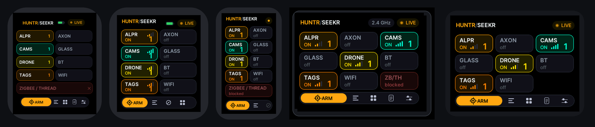
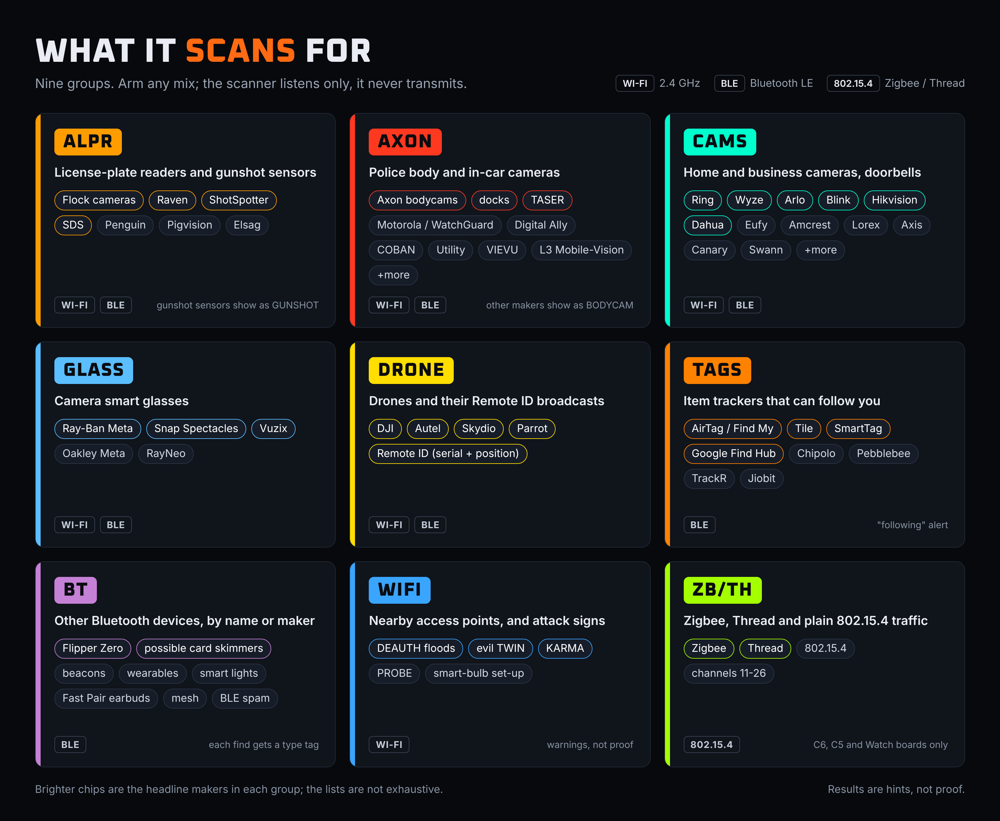

<div align="center">


**Counter-surveillance signal scanner for ESP32 boards**




<sub>Screen pictures are renderings of the interface produced by a simulator, not photographs of the boards.</sub>

</div>

## What it is

HUNTR/SEEKR turns a small ESP32 touch-screen board into a pocket radio scanner. It **listens** for the wireless signals that certain kinds of devices give off (security cameras, doorbells, license-plate readers, gunshot sensors, body cameras, smart glasses, drones, Bluetooth trackers and similar), compares them with built-in lists of known makers and names, and shows what it heard and how strong each signal is. A live signal meter lets you walk toward a source.

It is passive: it only receives. It does not jam, attack, or connect to anyone's network.

> **Results are hints, not proof.** Names and addresses can be changed or randomized, many devices are not in the lists, and a quiet device may simply be out of range. "Nothing found" never proves nothing is there.

## What it scans for

Everything it hears is sorted into groups. Arm any mix of them on the board; each group has its own colour on screen.



## Supported boards

Each board has its own folder with the source code, the user guide, plain-text help, build notes and licence notices. Start in the folder for your board.

| Board | Chip | Flash | Radios | Extras | Status |
|---|---|---|---|---|---|
| [Waveshare ESP32-C6-Touch-AMOLED-2.06](devices/watch-amoled206/) | ESP32-C6 | 16 MB | Wi-Fi 2.4 GHz, Bluetooth LE, Zigbee/Thread | AIM, SWEEP | Run on the board |
| [Waveshare ESP32-S3-Touch-LCD-1.69](devices/s3-lcd169/) | ESP32-S3 | 16 MB | Wi-Fi 2.4 GHz, Bluetooth LE | AIM, SWEEP | Run on the board (Wi-Fi and Bluetooth work) |
| [Waveshare ESP32-S3-Touch-LCD-1.47](devices/s3-lcd147/) | ESP32-S3 | 16 MB | Wi-Fi 2.4 GHz, Bluetooth LE | SWEEP (AIM only with a motion sensor) | Flashed and run on the board |
| [Waveshare ESP32-C6-Touch-LCD-1.47](devices/c6-lcd147/) | ESP32-C6 | 8 MB | Wi-Fi 2.4 GHz, Bluetooth LE, Zigbee/Thread | AIM, SWEEP | Run on the board |
| [Waveshare ESP32-C6-LCD-1.47, no touch (one button)](devices/c6-lcd147-button/) | ESP32-C6 | 4 MB | Wi-Fi 2.4 GHz, Bluetooth LE, Zigbee/Thread | - | Run on the board (starts and finds Wi-Fi networks) |
| [NM-CYD-C5](devices/c5-cyd/) | ESP32-C5 | 8 MB | Wi-Fi 2.4 GHz + 5 GHz, Bluetooth LE, Zigbee/Thread | - | Run on the board |
| [ESP32-2432S028 (CYD 2.8)](devices/cyd-2432s028/) | ESP32 | 4 MB | Wi-Fi 2.4 GHz, Bluetooth LE | - | Run on the board (Wi-Fi and Bluetooth work) |
| [Waveshare ESP32-Touch-LCD-3.5](devices/esp32-lcd35/) | ESP32 | 16 MB | Wi-Fi 2.4 GHz, Bluetooth LE | SWEEP | In field testing (port of the same firmware, still being tuned) |

"Status" is stated plainly in each board's README. Every board's firmware builds from the source in its folder; only the boards marked "Run on the board" have been run on real hardware by the project. Please report what you see on the others, good or bad.

## Install

1. Open the [Releases page](https://github.com/SKIrf26/HUNTR-SEEKR/releases), pick the release for your board (each board has its own), and download its `.bin` file together with `SHA256SUMS.txt`.
2. Flash it with `esptool` or with the project's [web flasher](https://skirf-labs.tech/) (Chrome or Edge on a computer). The exact steps and the flash address for each board are in that board's `help/2_FLASHING.txt` and `firmware/README.md`.

Not sure where to start? Open your board's folder and read `READ_ME_FIRST.txt`.

## Build from source

Each board's `docs/BUILDING.md` lists the Arduino IDE settings, the libraries (with versions) and the command-line build. The sketch for each board is a single folder under `src/`.

## Repository layout

```
devices/<board>/     one self-contained folder per board
    src/             the Arduino sketch
    config/          display and board set-up files
    docs/            user guide (PDF, three print formats), build notes, code map
    help/            plain-text help
    firmware/        how to flash and check the release .bin
    tools/           script that makes the release .bin from a build
    licenses/        full text of every third-party licence used by that board
docs/                shared project documents
```

## Contributing

Testing and bug reports are the most useful help right now. See [CONTRIBUTING.md](CONTRIBUTING.md). To report a security problem, see [SECURITY.md](SECURITY.md).

### Thanks

Thanks to Alfa ([@AlfaBeta2000](https://github.com/AlfaBeta2000)), who reported the Watch's slowdowns and spontaneous reboots ([#4](https://github.com/SKIrf26/HUNTR-SEEKR/issues/4)), traced them in the serial monitor to Bluetooth duplicate reports and found the fix that is now in every board's firmware. The full list is in [CONTRIBUTORS.md](CONTRIBUTORS.md).

## Licence

HUNTR/SEEKR is free software released under the **GNU General Public License v3.0** - see [LICENSE](LICENSE). It comes with **no warranty**. Copyright (C) 2026 SKIrf Labs.

It is built with third-party components under their own licences (LGPL, Apache 2.0, BSD, MIT, SIL OFL): see [THIRD_PARTY_NOTICES.md](THIRD_PARTY_NOTICES.md).

All brand and product names that appear in the detection lists or screenshots belong to their owners. This project is not affiliated with, or endorsed by, any of them.
