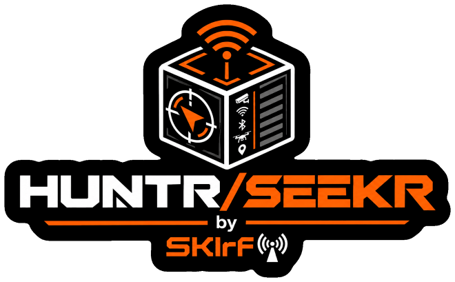

<div align="center">



**A pocket counter-surveillance signal scanner for small ESP32 touch-screen boards.**
It listens for the radio signals that cameras, trackers, drones and other gadgets give off, tells you what it heard, and helps you walk toward the source.


[**Download**](../../releases/latest) · [**Install**](#install) · [**Supported devices**](#supported-devices) · [**What it scans for**](#what-it-scans-for) · [**User guides**](#user-guides)

</div>

---

## What it is

HUNTR/SEEKR turns an inexpensive touch-screen ESP32 board into a pocket radio scanner. It **listens** for the wireless signals that certain kinds of devices give off, compares what it hears with built-in lists of known makers and network names, sorts the matches into **detection groups**, and shows you each one with a live signal strength. A **Track** screen then lets you walk toward a signal: the number climbs as you get closer.

It is **passive**. It only receives. It does not jam, attack, or connect to anyone's network.

> **Results are hints, not proof.** Names and addresses can be changed or randomized, many devices are not in the lists, and a quiet device may simply be out of range. "Nothing found" never proves nothing is there. A match is a clue about a device, not evidence about a person or a place.

</div>

## What it scans for

Everything is organised into **detection groups**. Arm the ones you care about; only armed groups are recorded.

| Group | Looks for | Radio |
|---|---|---|
| **ALPR** | Flock (cameras, Raven sensors, battery packs), Penguin, Pigvision, Ubicquia and Genetec AutoVu license-plate readers | Wi-Fi + Bluetooth |
| **AXON** | Body cameras, docks, TASER (Axon equipment), also recognised by Bluetooth service data and company ID | Wi-Fi + Bluetooth |
| **CAMS** | Wyze, Ring, Tapo, Reolink, Eufy, Nest, Arlo, Blink; police body and dash cameras (Digital Ally, WatchGuard, i-PRO, Utility BodyWorn, Motorola VideoManager); Verkada, Avigilon | Wi-Fi + Bluetooth |
| **GLASS** | Ray-Ban Meta (Wayfarer, Oakley Meta), Spectacles, Vuzix smart glasses | Wi-Fi + Bluetooth |
| **DRONE** | DJI, Autel, Skydio, Parrot, plus **Remote ID** broadcasts (serial number, position, height, speed, often the pilot's position) | Wi-Fi + Bluetooth |
| **BT** | Bluetooth devices by name or maker, with type tags: `IBEACON` `EDDYSTONE` `ALTBEACON` `WEARABLE` `LIGHT` `FASTPAIR` `MESH`; also public-safety radios and vehicle light-bar controllers (Motorola, L3Harris, Tait, Feniex, SoundOff, Whelen) | Bluetooth |
| **TAGS** | Tile, AirTag and other Find My trackers, SmartTag, Google Find Hub trackers, Chipolo, Pebblebee, TrackR, Jiobit | Bluetooth |
| **WIFI** | Any nearby 2.4 GHz access point; smart bulbs in set-up mode (WiZ, LIFX, Yeelight, tag `LIGHT`); vehicle routers (Cradlepoint, Sierra Wireless, Peplink) and rugged laptops/handhelds (Panasonic, Zebra, Datalogic) when recognised | Wi-Fi |
| **ZB/TH** *(not on the S3 or CYD 2.8)* | Zigbee, Thread and plain 802.15.4 devices (channels 11 to 26) | 802.15.4 |

### Extra checks

| Feature | What it does |
|---|---|
| **Tracker "following" alert** | A tracker that stays near you for 5, 10 or 20 minutes raises a red FOLLOWING alert, once per tracker. |
| **Skimmer watch** | Flags Bluetooth LE modules still wearing a factory name (HC-03, HC-05, HC-06, HC-08, linvor...), the kind sometimes hidden in gas pumps and ATM readers. Bluetooth LE only, so it is a clue, not a verdict. |
| **Rogue Wi-Fi signs** *(Watch, S3, C6)* | `DEAUTH` (de-authentication flood), `TWIN` (an open copy of a protected network name), `KARMA` (one transmitter answering to many names), and `PROBE` (devices asking for a named network). |
| **Drone Remote ID** | Decodes the ID, position, height and speed many drones broadcast, over Bluetooth or Wi-Fi. |
| **Your own rules** | Add detection rules (`ssid`, `oui`, `name`, `cid`, `uuid`...) from your phone. Up to 128 rules on the Watch, S3 and C6 (64 on the C5 and CYD 2.8), plus a separate `sigs_update.txt` for lists you receive from others. |

> Some signatures come from a published list that marks them as only *possible*: the maker also sells ordinary products. Those are listed quietly at low confidence with no alert.

### How strong is that signal?

Signal strength is shown in dBm. Closer to zero is stronger; every 10 dB is roughly a tenfold change in power.

| Reading | What it usually means |
|---|---|
| **-30 to -50** | Very close: within a few metres, often the same room |
| **-50 to -65** | Close: same room, or just through a wall |
| **-65 to -80** | Moderate: another room, or 10 to 20 metres in the open |
| **-80 to -90** | Weak: far away or heavily blocked |
| **below -90** | Barely detectable |

Treat this as rough. Walls, your own body and the other device's antenna can shift a reading by 10 to 20 dB.

### The one radio rule

These boards have a single 2.4 GHz radio shared by Wi-Fi, Bluetooth and 802.15.4. **Bluetooth groups (BT, TAGS) run alongside either side**, but Wi-Fi scanning and Zigbee/Thread scanning each need the radio to themselves, so you arm one side at a time. Tiles on the other side turn dim red and say *blocked*.

Wi-Fi side: `ALPR` `AXON` `CAMS` `GLASS` `DRONE` `WIFI` · 802.15.4 side: `ZB/TH`

> **Not seen:** anything on 5 GHz Wi-Fi (the app scans the 2.4 GHz band only), Bluetooth Classic devices, and devices that use a random address. Agency fleet Wi-Fi names are usually changed from the maker's default, so a router can go unseen.

## Supported devices

One shared code base, tuned for each board. Pick yours:

| | **Watch AMOLED 2.06** | **S3 LCD 1.69** | **C6 LCD 1.47** | **C5 CYD** | **CYD 2.8** |
|---|---|---|---|---|---|
| **Board** | Waveshare ESP32-C6-Touch-AMOLED-2.06 | Waveshare ESP32-S3-Touch-LCD-1.69 | Waveshare ESP32-C6-Touch-LCD-1.47 | NM-CYD-C5 ("cheap yellow display") | ESP32-2432S028 ("cheap yellow display") |
| **Chip** | ESP32-C6 | ESP32-S3 | ESP32-C6 | ESP32-C5 | ESP32 |
| **Screen** | 2.06" AMOLED, 410 x 502 | 1.69" IPS, 240 x 280 | 1.47" IPS, 172 x 320 | 2.8" LCD, 320 x 240, resistive | 2.8" LCD, 240 x 320, resistive |
| **Detection groups** | 9 | 8 (no ZB/TH) | 9 | 9 | 8 (no ZB/TH) |
| **Zigbee / Thread** | Yes | No | Yes | Yes | No |
| **Direction finding (AIM, beta) and SWEEP** | Yes | Yes | Yes | No (no motion sensor) | No (no motion sensor) |
| **Rogue Wi-Fi alerts** | Yes | Yes | Yes | - | - |
| **Sound** | Speaker | Buzzer | Optional buzzer (IO7) | Optional buzzer (IO26) | Optional speaker (IO26) |
| **Clock** | Built in | Built in | Set from your phone | Set from your phone | Set from your phone |
| **Update from phone** | Yes | Yes | USB only | USB only | USB only |
| **Guide** | [PDF](docs/HUNTR-SEEKR_Watch_AMOLED206_Public_Beta_1_User_Guide.pdf) | [PDF](docs/HUNTR-SEEKR_S3_LCD169_Public_Beta_1_User_Guide.pdf) | [PDF](docs/HUNTR-SEEKR_C6_LCD147_Public_Beta_1_User_Guide.pdf) | [PDF](docs/HUNTR-SEEKR_C5_CYD_Public_Beta_1_User_Guide.pdf) | Coming soon |

All boards support an optional GPS module for position stamps in the log.

<details>
<summary><b>Screenshots for each board</b></summary>

<br>

**Watch AMOLED 2.06** (arm, finds, track, watch face)


**S3 LCD 1.69** (arm, finds, track, log)


**C6 LCD 1.47** (arm, finds, groups, log)


**C5 CYD** (arm, finds, track, report)


</details>

## Features

- **Live detection groups** with counts and signal bars, plus one-tap **Scenes** (for example a SKIMMER scene for gas pumps)
- **Track** screen: a live dBm dial with zoom, a peak mark, HOTTER / COLDER, and a "PASSED IT" cue when you walk past the strongest point
- **AIM** *(Watch, S3, C6; beta)*: turn on the spot and the motion sensor works out which side the signal is strongest on
- **SWEEP** *(Watch, S3, C6)*: walk a place room by room, learn a baseline of what is normally there, then list what is new
- **Tracker alerts**, banners and per-group chimes; an ignore list for devices you do not care about
- **Findings record**: save logs as plain CSV tables, with a session report that charts each group
- **Phone page over the board's own hotspot** (WPA2, random password): live view, log download, custom rules, clock sync
- **Discreet mode** (silent, dim, no banners), **power saver**, portrait and landscape, auto-rotate where there is a motion sensor
- **Boot logo** of your own, and on the Watch a custom boot sound
- **Self-test** screen that checks every part of the hardware

## Install

You need a supported board, a USB-C **data** cable (some charge-only cables will not work), and a computer running Windows, macOS or Linux. No programming tools are needed: you flash one ready-made file.

## *USE THE WEB FLASHER LOCATED HERE!!! JUST PICK YOUR DEVICE AND FLASH!!! ([WEB FLASHER](https://skirf-labs.tech/)) *

**1. Download** your board's `.bin` and `SHA256SUMS.txt` from the [Releases page](../../releases/latest):

| Board | Firmware file | Chip name for esptool |
|---|---|---|
| Watch AMOLED 2.06 | `HUNTR-SEEKR_Watch_AMOLED206_Public_Beta_1.bin` | `esp32c6` |
| S3 LCD 1.69 | `HUNTR-SEEKR_S3_LCD169_Public_Beta_1.bin` | `esp32s3` |
| C6 LCD 1.47 | `HUNTR-SEEKR_C6_LCD147_Public_Beta_1.bin` | `esp32c6` |
| C5 CYD | `HUNTR-SEEKR_C5_CYD_Public_Beta_1.bin` | `esp32c5` |
| CYD 2.8 (ESP32-2432S028) | `HUNTR-SEEKR_CYD_2432S028_Public_Beta_1.bin` | `esp32` |

**2. Install the flashing tool** once. You need Python 3 ([python.org](https://www.python.org)), then:

```
pip install esptool
```

(On Windows, if `pip` is not found: `py -m pip install esptool`.)

**3. Plug the board in** and find its port: a COM port on Windows (Device Manager, for example `COM5`), `/dev/cu.usbmodem...` on macOS, usually `/dev/ttyACM0` on Linux.

**4. Flash it.** In a terminal, in the folder with the file (replace `YOUR_PORT`, the chip name and the file name for your board):

```
esptool --chip esp32c6 --port YOUR_PORT --baud 460800 write-flash 0x0 HUNTR-SEEKR_Watch_AMOLED206_Public_Beta_1.bin
```

Wait for `Hash of data verified` and `Hard resetting`. The board restarts by itself and shows **Public Beta 1** on the boot screen. The C5 and the CYD 2.8 ask you to calibrate the touch screen the first time (press and hold each of the four crosses).

<details>
<summary><b>If the computer cannot connect to the board</b></summary>

<br>

- Use a USB-C **data** cable and try another USB port.
- Put the chip in download mode: unplug the cable, hold the board's **BOOT** button, plug the cable in, release BOOT, and run the command again.
- If the connection is unreliable, use `--baud 115200`.
- On the CYD 2.8, if the upload stops with "Wrong boot mode detected" or never connects, hold **BOOT** while the command shows "Connecting...", or try another cable or USB port.

</details>

<details>
<summary><b>Check the download (optional)</b></summary>

<br>

| Computer | Command |
|---|---|
| Windows (PowerShell) | `Get-FileHash .\<file>.bin -Algorithm SHA256` and compare with `SHA256SUMS.txt` |
| macOS / Linux | `shasum -a 256 -c SHA256SUMS.txt` |

</details>

> Flashing replaces the software and **resets saved settings**. Logs already saved on the board (or on the microSD card of the C5 and CYD 2.8) are kept.

**Updating later.** Flash the newer file the same way. On the **Watch** and **S3** you can also update from your phone with no computer: download the `_app-only.bin` from the Releases page, tap **SHARE** on the LOG page, join the board's hotspot and open `192.168.4.1/update`. The C6, C5 and CYD 2.8 update over USB.

**First use.** Tap tiles on the **ARM** page to arm groups, watch the **FINDS** page fill, tap a find and press **TRACK**. Open **SETUP > Self-test** at any time: every dot should be green (a grey row is a part your board does not have).

## User guides

Each board has its own illustrated, printable guide covering set-up, every screen, the settings, troubleshooting and care:

| Board | Guide |
|---|---|
| Watch AMOLED 2.06 | [HUNTR-SEEKR_Watch_AMOLED206_Public_Beta_1_User_Guide.pdf](docs/HUNTR-SEEKR_Watch_AMOLED206_Public_Beta_1_User_Guide.pdf) |
| S3 LCD 1.69 | [HUNTR-SEEKR_S3_LCD169_Public_Beta_1_User_Guide.pdf](docs/HUNTR-SEEKR_S3_LCD169_Public_Beta_1_User_Guide.pdf) |
| C6 LCD 1.47 | [HUNTR-SEEKR_C6_LCD147_Public_Beta_1_User_Guide.pdf](docs/HUNTR-SEEKR_C6_LCD147_Public_Beta_1_User_Guide.pdf) |
| C5 CYD | [HUNTR-SEEKR_C5_CYD_Public_Beta_1_User_Guide.pdf](docs/HUNTR-SEEKR_C5_CYD_Public_Beta_1_User_Guide.pdf) |
| CYD 2.8 | Coming soon |

## Beta status: what to expect

This is the **first public beta**. It does what the guides describe, but expect rough edges, and expect some behaviour to change in later releases.

- Signal strength is only a rough guide to distance. One antenna cannot measure direction directly: use the warmer / colder reading and walk around, or try AIM where your board has it.
- The scanner hears **2.4 GHz only**. 5 GHz Wi-Fi and Bluetooth Classic are not seen.
- Sound on the C6 and C5 needs a small **passive** buzzer you fit yourself (see the guide for the pads). On the CYD 2.8, sound needs a small speaker plugged into the board's speaker socket.
- The CYD 2.8 is new in this release and has had less testing than the other boards.
- Detection lists are not exhaustive, and what is heard depends heavily on where you are.

Found a problem? Open an issue and say which board you have, what you were doing, and what the screen showed.

## Responsible use

This project is meant for defensive, privacy-protecting use: finding out what is around you. Receiving radio signals that are openly broadcast is lawful in many places, but laws differ, and some places restrict particular uses of scanners or of the information you collect. You are responsible for following the laws where you are. Do not use it to identify, follow or harass individual people.

## Licence

HUNTR/SEEKR is free software released under the **GNU General Public License v3.0**: see [LICENSE](LICENSE). It comes with **no warranty**. It includes third-party components under their own licences: see [THIRD_PARTY_NOTICES.md](THIRD_PARTY_NOTICES.md).

Waveshare, RockBase, NMTech, Espressif and all brand and product names that appear in the detection lists or screenshots belong to their owners. This project is not affiliated with, or endorsed by, any of them.
