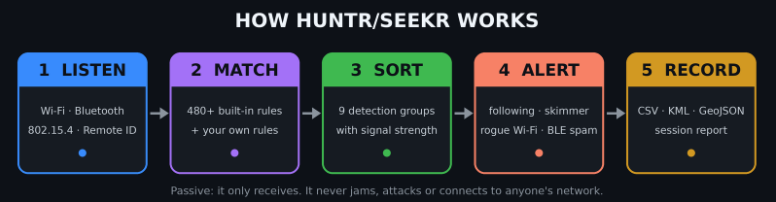

<div align="center">


# HUNTR/SEEKR

**A pocket counter-surveillance signal scanner for small ESP32 touch-screen boards.**
It listens for the radio signals that cameras, trackers, drones and other gadgets give off, tells you what it heard, and helps you walk toward the source.


-lightgrey)


[**Download**](../../releases/latest) · [**Install**](#install) · [**Supported devices**](#supported-devices) · [**What's new**](#whats-new) · [**What it scans for**](#what-it-scans-for) · [**The lists**](#what-it-finds-the-lists) · [**Alerts**](#alerts) · [**User guides**](#user-guides)

</div>

---

## What it is

HUNTR/SEEKR turns an inexpensive touch-screen ESP32 board into a pocket radio scanner. It **listens** for the wireless signals that certain kinds of devices give off, compares what it hears with built-in lists of known makers, network names and Bluetooth identifiers, sorts the matches into **detection groups**, and shows you each one with a live signal strength. A **Track** screen then lets you walk toward a signal: the number climbs as you get closer.

It is **passive**. It only receives. It does not jam, attack, or connect to anyone's network.

<div align="center">



</div>

> **Results are hints, not proof.** Names and addresses can be changed or randomized, many devices are not in the lists, and a quiet device may simply be out of range. "Nothing found" never proves nothing is there. A match is a clue about a device, not evidence about a person or a place.

### At a glance

| | |
|---|---|
| **Built-in rules** | **480+** address, name, company-ID and service rules, plus 15 longer address prefixes and 4,000+ Bluetooth company names for labelling |
| **Groups** | 9 detection groups (8 on boards without 802.15.4) |
| **Signals** | Wi-Fi · Bluetooth LE · Zigbee / Thread · drone Remote ID (Bluetooth, Wi-Fi beacon, Wi-Fi Aware) |
| **Alerts** | Tracker following you · card skimmer · de-auth flood · evil twin · karma · probe · BLE spam |
| **Your own rules** | Up to 128, from your phone, plus a drop-in `sigs_update.txt` |
| **Findings** | CSV, KML and GeoJSON (with an optional GPS module) |
| **Boards** | Watch AMOLED 2.06 · S3 LCD 1.69 · C6 LCD 1.47 · C5 CYD · CYD 2.8 |

---

## What's new

The **Watch AMOLED 2.06** and the **C5 CYD** carry the newest release: the expanded detection lists, a rebuilt radio handler and a set of new alerts. The S3, C6 and CYD 2.8 keep the earlier edition until their update (see [Supported devices](#supported-devices)).

| | New in this release | Watch | C5 CYD |
|---|---|:---:|:---:|
| 📚 | **Expanded lists**: 263 Wi-Fi maker prefixes (Hikvision, Dahua, Amcrest, Lorex, Axis, Vivotek, Hanwha and more), 43 network-name words, 28 name patterns, 72 Bluetooth prefixes, 32 Bluetooth names, 11 company IDs | ✅ | ✅ |
| 🏷️ | **4,022 Bluetooth company names** shown on a row when the maker is known | ✅ | ✅ |
| 🔁 | **Reliable radio start and stop**: arm and disarm groups in any order; Wi-Fi switches off when only Bluetooth is armed; a radio that fails to start is restarted automatically | ✅ | ✅ |
| 🔀 | **Bluetooth share**: Wi-Fi pauses 2 seconds in every 6 so Bluetooth gets longer to listen when both are armed | ✅ | ✅ |
| 🤫 | **Quiet Bluetooth** while Wi-Fi runs, with a short name-reading scan every 25 seconds | ✅ | ✅ |
| ⚡ | **Smoother screen**: what a repeating device matches is remembered, so the long lists are walked once instead of for every frame | ✅ | ✅ |
| 🛰️ | **Rogue Wi-Fi alerts**: `DEAUTH`, `TWIN`, `KARMA`, plus `PROBE` listing | ✅ | ✅ |
| 📢 | **BLE spam** detection (Apple, Google Fast Pair, Microsoft Swift Pair pop-up floods) | ✅ | ✅ |
| 🔎 | **Device fingerprints** (`IE-fp`) so a camera that changes its name can still be matched | ✅ | ✅ |
| 🚁 | **Remote ID over Wi-Fi Aware** as well as Bluetooth and Wi-Fi beacons | ✅ | ✅ |
| 🧩 | **Custom rules**: new `ie` kind, up to 128 rules, and a `sigs_update.txt` file read after yours | ✅ | ✅ |
| 🗺️ | **KML and GeoJSON** map files alongside CSV when a GPS module is fitted | ✅ | ✅ |
| 📡 | **5 GHz Wi-Fi** option, with a band label (2.4 / 5 GHz) at the top of the main pages | - | ✅ |
| 🩺 | **Self-test** shows radio timing and the step the board was in if it restarted unexpectedly | ✅ | ✅ |
| 🧭 | **AIM direction finder** with a gyro check and 5-point calibration | ✅ | - |

---

## What it scans for

Everything is organised into **detection groups**. Arm the ones you care about; only armed groups are recorded. A tag on each row says why it matched.

| Group | Looks for | Radio |
|---|---|---|
| 🚗 **ALPR** | Flock (cameras, Raven sensors, battery packs), Penguin, Pigvision, Ubicquia and Genetec AutoVu license-plate readers | Wi-Fi + Bluetooth |
| 🛡️ **AXON** | Body cameras, docks, TASER (Axon equipment), also recognised by Bluetooth service data and company ID | Wi-Fi + Bluetooth |
| 📷 **CAMS** | Wyze, Ring, Tapo, Reolink, Eufy, Nest, Arlo, Blink; Hikvision, Dahua, Amcrest, Lorex, Vivotek, Hanwha, Axis; police body and dash cameras (Digital Ally, WatchGuard, i-PRO, Utility BodyWorn, Motorola VideoManager, Coban); Verkada, Avigilon; hidden-camera name hints | Wi-Fi + Bluetooth |
| 🕶️ **GLASS** | Ray-Ban Meta (Wayfarer, Oakley Meta), Luxottica, Snap Spectacles, Vuzix, Epson Moverio, RayNeo | Wi-Fi + Bluetooth |
| 🚁 **DRONE** | DJI, Autel, Skydio, Parrot, Anafi, FPV names, plus **Remote ID** broadcasts (serial number, position, height, speed, often the pilot's position) | Wi-Fi + Bluetooth |
| 📻 **BT** | Bluetooth devices by name or maker, with type tags: `IBEACON` `EDDYSTONE` `ALTBEACON` `WEARABLE` `LIGHT` `FASTPAIR` `MESH` `SKIMMER`; also public-safety radios and vehicle light-bar controllers (Motorola, L3Harris, Tait, Hytera, Feniex, SoundOff, Whelen) | Bluetooth |
| 📍 **TAGS** | AirTag and other Find My trackers, Tile, Samsung SmartTag, Google Find Hub, Chipolo, Pebblebee, TrackR, Jiobit, Cube, Nutale, Eufy SmartTrack, Orbit | Bluetooth |
| 📶 **WIFI** | Nearby access points; smart bulbs in set-up mode (tag `LIGHT`); vehicle routers (Cradlepoint, Sierra Wireless, Peplink) and rugged laptops/handhelds (Panasonic Toughbook, Zebra, Datalogic, Havis) when recognised. Tags: `PROBE` `DEAUTH` `TWIN` `KARMA` | Wi-Fi |
| 🐝 **ZB/TH** *(not on the S3 or CYD 2.8)* | Zigbee, Thread and plain 802.15.4 devices (channels 11 to 26) | 802.15.4 |

### Extra checks

| Feature | What it does |
|---|---|
| **Tracker "following" alert** | A tracker that stays near you for 5, 10 or 20 minutes raises a red `FOLLOWING` alert, once per tracker. |
| **Skimmer watch** | Flags Bluetooth LE modules still wearing a factory name (HC-03, HC-05, HC-06, HC-08, Linvor, RNBT-xxxx...), the kind sometimes hidden in gas pumps and ATM readers. Bluetooth LE only, so it is a clue, not a verdict. |
| **Rogue Wi-Fi signs** *(Watch, C5, S3, C6)* | `DEAUTH` (de-authentication flood), `TWIN` (an open copy of a protected network name), `KARMA` (one transmitter answering to many names), and `PROBE` (devices asking for a named network). |
| **BLE spam** *(Watch, C5)* | Pop-up spam floods imitating Apple, Google Fast Pair and Microsoft Swift Pair devices are labelled `BLE SPAM`. |
| **Device fingerprints** *(Watch, C5)* | Wi-Fi devices are also recognised by the shape of their own frames and shown as `IE-fp` with a code, so a camera that changes its name can still be matched. |
| **Drone Remote ID** | Decodes the ID, position, height and speed many drones broadcast, over Bluetooth, Wi-Fi beacons or (Watch, C5) Wi-Fi Aware. |
| **Your own rules** | Add detection rules (`oui`, `ssid`, `ble`, `cid`, `uuid`, `ie`) from your phone. See [Your own rules](#your-own-rules). |
| **Maps** *(with the optional GPS module)* | Save findings as CSV, or as KML / GeoJSON to open on a map. |

> Some signatures come from a published list that marks them as only *possible*: the maker also sells ordinary products. Those are listed quietly at low confidence with no alert.

### How strong is that signal?

Signal strength is shown in dBm. Closer to zero is stronger; every 10 dB is roughly a tenfold change in power.

| Reading | What it usually means |
|---|---|
| **-30 to -50** | Very close: within a few metres, often the same room |
| **-50 to -65** | Close: same room, or just through a wall |
| **-65 to -80** | Moderate: another room, or 10 to 20 metres in the open |
| **-80 to -90** | Weak: far away or heavily blocked |
| **below -90** | Barely detectable |

Treat this as rough. Walls, your own body and the other device's antenna can shift a reading by 10 to 20 dB.

### The one radio rule

These boards share one radio between Wi-Fi, Bluetooth and 802.15.4. **Bluetooth groups (BT, TAGS) run alongside either side**, but Wi-Fi scanning and Zigbee/Thread scanning each need the radio to themselves, so you arm one side at a time. Tiles on the other side turn dim red and say *blocked*.

Wi-Fi side: `ALPR` `AXON` `CAMS` `GLASS` `DRONE` `WIFI` · 802.15.4 side: `ZB/TH`

When Wi-Fi and Bluetooth are both armed they take turns on the radio. On the **Watch and C5**:

- Groups can be armed and disarmed in **any order**. The Wi-Fi radio is switched off when only Bluetooth is armed.
- Bluetooth listens **quietly** while Wi-Fi runs, with a short name-reading scan every 25 seconds.
- **Bluetooth share** (SETUP) lets Bluetooth listen for longer by pausing Wi-Fi for 2 seconds in every 6.
- A radio that does not start is **restarted automatically**, and Self-test shows the radio timing and the step in progress if the board ever restarted unexpectedly.

> **Not seen:** Bluetooth Classic devices, and devices that use a random address. Agency fleet Wi-Fi names are usually changed from the maker's default, so a router can go unseen. **5 GHz Wi-Fi** is only scanned by the **C5 CYD**, which can listen on either band (choose it in SETUP > Wi-Fi band; the current band is shown at the top of the main pages). On 5 GHz, channels that need a radar check (52 to 144) are not scanned. Every other board scans 2.4 GHz only.

---

## What it finds: the lists

The rules built into the **Watch** and the **C5 CYD** (the updated list edition). Counts are the number of entries in each list.

| List | Entries | What it matches |
|---|---|---|
| Wi-Fi maker prefixes | **263** (+15 longer) | The first 3 bytes of a hardware address (the maker) |
| Wi-Fi network-name words | **43** | A word at the start of a network name |
| Wi-Fi name patterns | **28** | Anchored patterns such as a prefix followed by an ID |
| Bluetooth address prefixes | **72** (+2 longer) | The maker part of a Bluetooth address |
| Bluetooth names | **32** | Words in the advertised device name |
| Bluetooth name patterns | **10** | Anchored patterns for radios and light bars |
| Bluetooth company IDs | **11** | The 16-bit company code inside a Bluetooth advertisement |
| Bluetooth service IDs | **7** (+ built-in service checks) | Services a device advertises |
| Bluetooth company names | **4,022** | Used to label a row with the maker's name |

### Wi-Fi

Wi-Fi matching uses the hardware address, the network name, a device fingerprint and a few channel and frame checks.

<details>
<summary><b>Maker prefixes (263 + 15 longer)</b>: who the hardware address belongs to</summary>

<br>

| Maker | Prefixes | | Maker | Prefixes |
|---|---|---|---|---|
| **Hikvision** | 84 | | Dahua | 31 |
| Flock | 29 | | Zebra | 17 |
| Ring | 13 | | DJI | 8 |
| Sierra Wireless | 7 | | Parrot | 5 |
| Wyze | 5 | | Axon | 4 |
| Meta | 4 | | Peplink | 4 |
| Toughbook (Panasonic) | 3 | | Datalogic | 3 |
| Amcrest | 3 | | Axis | 3 |
| Flock battery packs | 2 | | Reolink | 2 |
| Eufy | 2 | | Cradlepoint | 2 |
| Genetec | 2 | | Hanwha | 2 |
| Jenoptik | 2 | | | |

**One prefix each:** Nest, Luxottica, Vuzix, Digital Ally, WatchGuard, i-PRO, Havis, Ubicquia, Verkada, Avigilon, SoundThink, Skydio, Lorex, Vivotek, VieVu, Safety Vision, Elsag, Selex, Neology, Kapsch, Redflex, ZepCam, Pro-Vision, SEON, Digital Barriers, Decatur Radar.

**Longer prefixes (15)**, used where a maker shares a short prefix with others: Federal Signal, Xplore, Axis, Amcrest, Genetec, Elsag, Selex (2), Perceptics, Ekin, Safety Vision, L3 Mobile-Vision, Rosco, Stalker Radar, Kustom Signals.

</details>

<details>
<summary><b>Network names (43 words + 28 patterns)</b>: what the Wi-Fi name starts with</summary>

<br>

**Words (43)**

| Group | Names |
|---|---|
| ALPR | `Flock`, `FS Ext Battery`, `Penguin`, `Pigvision`, `test_flck`, `flck` |
| AXON | `AB2-`, `AB3-`, `AB4-`, `AXON-` |
| CAMS | `WYZE`, `wzap`, `Blink-`, `Arlo`, `Ring-`, `ring-doorbell`, `Tapo_C`, `Tapo_`, `Reolink`, `eufyCam`, `eufy`, `Nest`, `IPC-` |
| GLASS | `Ray-Ban`, `RayBan` |
| DRONE | `DJI-`, `DJI_`, `MAVIC`, `MINI-`, `AIR2`, `AVATA`, `Autel`, `Skydio`, `Parrot`, `ANAFI`, `Phantom`, `Inspire`, `Mini2`, `FPV-` |
| WIFI | `FIRSTNET`, `LEnet` |

**Patterns (28)**

| Kind | Matches |
|---|---|
| Vehicle routers | Pepwave; Cradlepoint (`IBR`, R-series, `Cradlepoint-`); Sierra Wireless (`Sierra#`, `MP70`, `RV50`, `AirLink`) |
| Axon | `ABX`, `AB3`, `AB4`, `AF3` device IDs |
| Body and dash cameras | Motorola `VM-` and `SI500-`; WatchGuard `V300-` and `4RE-`; Digital Ally `FirstVu-`; Coban |
| Hidden-camera names | `IPC-` + hex ID, `IPCAM`, `HDWiFiCam`, `WiFiCam`, `YsxLite`, `MV` + digits, `A9-`, `P2P-`, `CAM-` |
| Law-enforcement networks | `PD-` and `SO-` network names |

</details>

<details>
<summary><b>Smart bulbs in set-up mode</b>: tagged <code>LIGHT</code></summary>

<br>

WiZ, LIFX, Kasa (smart bulb), TP-Link (smart bulb), Yeelight, Smart Life, Magic Home, LEDnet, Nanoleaf, Govee and Hue bulbs announce a network while they wait to be set up; they are shown with the `LIGHT` tag instead of as unknown access points.

</details>

<details>
<summary><b>Behaviour checks</b>: what a device is doing, not what it is</summary>

<br>

| Check | Tag |
|---|---|
| A transmitter sends 15+ de-authentication frames in a second | `DEAUTH` |
| A name heard open on one access point and protected on another, from a different maker | `TWIN` |
| One transmitter answers probes for 5+ different names within 30 s | `KARMA` |
| A device asks for a named network | `PROBE` |
| A device matched by the shape of its own frames | `IE-fp` + code |
| Drone Remote ID in a beacon or Wi-Fi Aware frame | `RID` |

</details>

### Bluetooth

Bluetooth matching reads the address prefix, the advertised name, the company ID, the services a device advertises and a few payload markers.

<details>
<summary><b>Address prefixes (72 + 2 longer)</b></summary>

<br>

| Maker | Prefixes | | Maker | Prefixes |
|---|---|---|---|---|
| Zebra | 17 | | Ring | 11 |
| Motorola | 7 | | Sierra Wireless | 6 |
| Peplink | 4 | | Toughbook (Panasonic) | 3 |
| Datalogic | 3 | | Meta | 2 |
| DJI | 2 | | Cradlepoint | 2 |
| Hytera | 2 | | Utility | 2 |

**One prefix each:** Axon, Flock, Luxottica, Vuzix, Digital Ally, WatchGuard, i-PRO, Ubicquia, Verkada, Avigilon, SoundThink.

**Longer prefixes (2):** Federal Signal, Xplore.

</details>

<details>
<summary><b>Names (32 + 10 patterns)</b></summary>

<br>

**Names (32):** `AXON`, `TASER`, `BWCDEVICE`, `FSExtBattery`, `FSExt`, `Penguin`, `rayban`, `ray-ban`, `meta_rb`, `Wayfarer`, `OakleyMeta`, `spectacles`, `vuzix`, `moverio`, `rayneo`, `DJI`, `MAVIC`, `Tile`, `tile_`, `AirTag`, `SmartTag`, `GalaxySmartTag`, `Chipolo`, `Pebblebee`, `TrackR`, `Jiobit`, `CubeTracker`, `Nutale`, `eufySmartTrack`, `OrbitTrack`, `BodyWornRemote`, `MeshCore-`.

**Patterns (10):**

| Maker | Matches |
|---|---|
| L3Harris | `XL200` radios |
| Motorola | `APX` radios |
| Tait | Tait radios |
| Feniex | `Feniex4200` light bars |
| SoundOff Signal | `ConfigureIT`, `ECTBM`, `SOS-` |
| Whelen | `SL+`, `ScanLock`, `PROGRAM2` |

</details>

<details>
<summary><b>Company IDs (11) and services</b></summary>

<br>

| Company | ID | Group |
|---|---|---|
| Meta | `0x01AB` | GLASS |
| Meta Technologies | `0x058E` | GLASS |
| Luxottica | `0x0D53` | GLASS |
| Snap | `0x03C2` | GLASS |
| Vuzix | `0x060C` | GLASS |
| RayNeo | `0x0BC6` | GLASS |
| Tile | `0x067C` | TAGS |
| Axon | `0x034D` | AXON |
| Motorola | `0x04EC`, `0x0008` | BT |
| Flock | `0x09C8` | ALPR |

**Services (7):** Axon `FC81` and `FE6B`; Raven sensor services `3100` to `3500`.

**Built-in service and payload checks:** Axon `FE6C`, smart glasses `FD5F`, Tile `FEED`/`FEEC`, Samsung SmartTag `FD5A`, Chipolo `FE65`, Google Find Hub (`FEAA` frame types 0x40/0x41), drone Remote ID `FFFA`, DJI `FFE0`, Apple Find My (offline-finding frames, not ordinary iPhone chatter), and the `BWCDEVICE` marker in service data.

</details>

<details>
<summary><b>Type tags</b>: what an unnamed device is</summary>

<br>

| Tag | Shown for |
|---|---|
| `IBEACON` | Apple iBeacon (shows the beacon ID and major/minor numbers) |
| `EDDYSTONE` | Eddystone UID, URL, TLM and EID frames |
| `ALTBEACON` | AltBeacon frames |
| `WEARABLE` | Watches, bands, rings and heart-rate straps: Fitbit, Garmin, Amazfit / Huami, Polar, Suunto, Coros, Whoop, Oura, Withings, Wahoo, Pebble, Timex, Casio and more |
| `LIGHT` | Smart lights and LED strips: Govee, Philips Hue / Signify, Nanoleaf, LIFX, WiZ, Sengled, Lutron, OSRAM, LEDVANCE, OPPLE, Yeelight and more |
| `FASTPAIR` | Google Fast Pair accessories such as earbuds (not a tracker by itself) |
| `MESH` | Bluetooth Mesh nodes |
| `SKIMMER` | Factory-named serial modules: HC-03, HC-05, HC-06, HC-08, Linvor, RNBT-xxxx |

When the maker is known from the Bluetooth company ID, the maker's name is shown on the row.

</details>

### Alerts

These are behaviours rather than device lists. The tracker, skimmer and rogue Wi-Fi alerts each have a switch under SETUP.

| Alert | Tag | Triggers when |
|---|---|---|
| Tracker following you | `FOLLOWING` | A tracker has been heard continuously for the set number of minutes (5, 10 or 20) |
| Card skimmer | `SKIMMER` | A Bluetooth module still shows a factory name: HC-03, HC-05, HC-06, HC-08, Linvor or RNBT-xxxx |
| De-auth attack | `DEAUTH` | One transmitter sends 15 or more de-authentication frames within a second |
| Evil twin | `TWIN` | A network name is heard open on one access point and protected on another from a different maker |
| Karma | `KARMA` | One transmitter answers probes for 5 or more different network names within 30 s |
| Probe | `PROBE` | A device is asking for a named network |
| BLE spam | `BLE SPAM` | A flood of fake Apple, Fast Pair or Swift Pair pairing pop-ups |
| Drone Remote ID | `RID` | A drone broadcasts its serial number and position, read and shown on the row |

### Your own rules

Add up to **128** rules of your own: a Wi-Fi or Bluetooth address prefix (`oui`), a Wi-Fi name (`ssid`), a Bluetooth name (`ble`), a company ID (`cid`), a service ID (`uuid`) or a Wi-Fi device fingerprint (`ie`), each assigned to a group and a confidence. Edit them on the phone page (`sigs.txt`), or drop a `sigs_update.txt` file on the storage and it is added after yours. On the Watch you can also upload a signature update file from the phone page.

```
# kind   pattern      group   [confidence]
oui      B4:1E:52     ALPR    high
ssid     MyCamNet     CAMS
ie       1A2B3C4D     CAMS
```

### Board differences

| Board | List edition | Wi-Fi bands | 802.15.4 (ZB/TH group) |
|---|---|---|---|
| Watch AMOLED 2.06 | Updated (this section) | 2.4 GHz | Yes |
| C5 CYD | Updated (this section) | 2.4 GHz **and** 5 GHz | Yes |
| C6 LCD 1.47 | Earlier edition | 2.4 GHz | Yes |
| S3 LCD 1.69 | Earlier edition | 2.4 GHz | No, so eight groups |
| CYD 2.8 | Earlier edition | 2.4 GHz | No, so eight groups |

The lists above are the **updated edition** found on the Watch and the C5 CYD. The other boards carry an earlier, smaller edition of the same lists and receive the update in a later release; their groups, alerts and tags work the same way.

---

## Finding it: Track, AIM and SWEEP

- **Track**: tap a find and press **TRACK**. A live dBm display (a ring on the Watch) with zoom, a peak mark, HOTTER / COLDER, a "PASSED IT" cue when you walk past the strongest point, and audible feedback. Bluetooth tracking keeps its sound steady.
- **AIM** *(Watch, S3, C6; beta)*: turn on the spot and the motion sensor works out which side the signal is strongest on. On the Watch, AIM starts with a gyro check and a 5-point calibration (turn right 90, 180 and 270 degrees and back), then shows a direction arrow with an uncertainty arc, with REDO, FLIP and NUM buttons. It is an estimate, never better than +/-15 degrees.
- **SWEEP** *(Watch, S3, C6)*: walk a place room by room, learn a baseline of what is normally there, then list what is new.
- **C5 CYD and CYD 2.8** have one antenna and no motion sensor, so they cannot tell direction: use HOTTER / COLDER and walk around.

## Records and the phone page

- **Findings record**: save logs as plain CSV tables, or as **KML / GeoJSON** map files when a GPS module is fitted *(Watch, C5)*, with a session report that charts each group. Logs go to the microSD card or flash on the C5 and CYD 2.8.
- **Phone page over the board's own hotspot** (WPA2, random password): live view, log download, custom rules, clock sync. On the Watch it also takes firmware updates and a signature update file.
- **Ignore list**, one-tap **Scenes** (for example a SKIMMER scene for gas pumps), and a baseline for SWEEP.

---

## Supported devices

One shared code base, tuned for each board. Pick yours:

| | **Watch AMOLED 2.06** | **S3 LCD 1.69** | **C6 LCD 1.47** | **C5 CYD** | **CYD 2.8** |
|---|---|---|---|---|---|
| **Board** | Waveshare ESP32-C6-Touch-AMOLED-2.06 | Waveshare ESP32-S3-Touch-LCD-1.69 | Waveshare ESP32-C6-Touch-LCD-1.47 | NM-CYD-C5 ("cheap yellow display") | ESP32-2432S028 ("cheap yellow display") |
| **Chip** | ESP32-C6 | ESP32-S3 | ESP32-C6 | ESP32-C5 | ESP32 |
| **Screen** | 2.06" AMOLED, 410 x 502 | 1.69" IPS, 240 x 280 | 1.47" IPS, 172 x 320 | 2.8" LCD, 320 x 240, resistive | 2.8" LCD, 240 x 320, resistive |
| **Detection groups** | 9 | 8 (no ZB/TH) | 9 | 9 | 8 (no ZB/TH) |
| **Detection lists** | Updated | Earlier | Earlier | Updated | Earlier |
| **Wi-Fi bands** | 2.4 GHz | 2.4 GHz | 2.4 GHz | 2.4 GHz + 5 GHz | 2.4 GHz |
| **Zigbee / Thread** | Yes | No | Yes | Yes | No |
| **Radio handling** (any-order arming, Bluetooth share, auto-restart) | Yes | Earlier | Earlier | Yes | Earlier |
| **Rogue Wi-Fi alerts** | Yes | Yes | Yes | Yes | - |
| **BLE spam, device fingerprints, Wi-Fi Aware Remote ID** | Yes | Later update | Later update | Yes | Later update |
| **KML / GeoJSON map files** (with GPS) | Yes | Later update | Later update | Yes | Later update |
| **Direction finding (AIM, beta) and SWEEP** | Yes | Yes | Yes | No (no motion sensor) | No (no motion sensor) |
| **Sound** | Speaker | Buzzer | Optional buzzer (IO7) | Optional passive buzzer (IO26) | Optional speaker (IO26) |
| **Clock** | Built in | Built in | Set from your phone | Set from your phone | Set from your phone |
| **Update from phone** | Yes | Yes | USB only | USB only | USB only |
| **Guide** | [PDF](docs/HUNTR-SEEKR_Watch_AMOLED206_Public_Beta_1_User_Guide.pdf) | [PDF](docs/HUNTR-SEEKR_S3_LCD169_Public_Beta_1_User_Guide.pdf) | [PDF](docs/HUNTR-SEEKR_C6_LCD147_Public_Beta_1_User_Guide.pdf) | [PDF](docs/HUNTR-SEEKR_C5_CYD_Public_Beta_1_User_Guide.pdf) | [PDF](docs/HUNTR-SEEKR_28_CYD_Public_Beta_1_User_Guide.pdf) |

All boards support an optional GPS module for position stamps in the log.

---

## Features

- **Live detection groups** with counts and signal bars, plus one-tap **Scenes**
- **Track** screen with a live dBm display, HOTTER / COLDER and a "PASSED IT" cue
- **AIM** *(Watch, S3, C6; beta)* and **SWEEP** *(Watch, S3, C6)*
- **Alerts**: tracker following, card skimmer, rogue Wi-Fi, BLE spam, drone Remote ID; banners and per-group chimes; an ignore list for devices you do not care about
- **Findings record**: CSV, KML and GeoJSON, with a session report that charts each group
- **Phone page over the board's own hotspot** (WPA2, random password): live view, log download, custom rules, clock sync
- **Smooth, steady scanning** *(Watch, C5)*: Wi-Fi and Bluetooth share the radio sensibly, and repeat sightings are remembered so the screen stays responsive in a busy place
- **Discreet mode** (silent, dim, no banners), **power saver**, portrait and landscape, auto-rotate where there is a motion sensor
- **Boot logo** of your own, and on the Watch a custom boot sound
- **Self-test** screen that checks every part of the hardware, with radio timing on the Watch and C5

---

## Install

You need a supported board, a USB-C **data** cable (some charge-only cables will not work), and a computer running Windows, macOS or Linux. No programming tools are needed: you flash one ready-made file.

## *USE THE WEB FLASHER LOCATED HERE!!! JUST PICK YOUR DEVICE AND FLASH!!! ([WEB FLASHER](https://skirf-labs.tech/)) *

**1. Download** your board's `.bin` and `SHA256SUMS.txt` from the [Releases page](../../releases/latest):

| Board | Firmware file | Chip name for esptool |
|---|---|---|
| Watch AMOLED 2.06 | `HUNTR-SEEKR_Watch_AMOLED206_Public_Beta_1.bin` | `esp32c6` |
| S3 LCD 1.69 | `HUNTR-SEEKR_S3_LCD169_Public_Beta_1.bin` | `esp32s3` |
| C6 LCD 1.47 | `HUNTR-SEEKR_C6_LCD147_Public_Beta_1.bin` | `esp32c6` |
| C5 CYD | `HUNTR-SEEKR_C5_CYD_Public_Beta_1.bin` | `esp32c5` |
| CYD 2.8 (ESP32-2432S028) | `HUNTR-SEEKR_CYD_2432S028_Public_Beta_1.bin` | `esp32` |

**2. Install the flashing tool** once. You need Python 3 ([python.org](https://www.python.org)), then:

```
pip install esptool
```

(On Windows, if `pip` is not found: `py -m pip install esptool`.)

**3. Plug the board in** and find its port: a COM port on Windows (Device Manager, for example `COM5`), `/dev/cu.usbmodem...` on macOS, usually `/dev/ttyACM0` on Linux.

**4. Flash it.** In a terminal, in the folder with the file (replace `YOUR_PORT`, the chip name and the file name for your board):

```
esptool --chip esp32c6 --port YOUR_PORT --baud 460800 write-flash 0x0 HUNTR-SEEKR_Watch_AMOLED206_Public_Beta_1.bin
```

Wait for `Hash of data verified` and `Hard resetting`. The board restarts by itself and shows **Public Beta 1** on the boot screen. The C5 and the CYD 2.8 ask you to calibrate the touch screen the first time (press and hold each of the four crosses); you can repeat it later from SETUP.

<details>
<summary><b>If the computer cannot connect to the board</b></summary>

<br>

- Use a USB-C **data** cable and try another USB port.
- Put the chip in download mode: unplug the cable, hold the board's **BOOT** button, plug the cable in, release BOOT, and run the command again.
- If the connection is unreliable, use `--baud 115200`.
- On the CYD 2.8, if the upload stops with "Wrong boot mode detected" or never connects, hold **BOOT** while the command shows "Connecting...", or try another cable or USB port.

</details>

<details>
<summary><b>If a radio does not seem to start or the board restarts</b></summary>

<br>

- On the Watch and C5 a radio that does not start is restarted automatically; give it a few seconds.
- Open **SETUP > Self-test**. The radio timing shows when the first Wi-Fi and Bluetooth signals were heard and how many restarts there were, and **Last start** shows whether the board started normally or which step it was in when it last restarted.
- Try disarming every group, then arming one side again. Groups can be armed and disarmed in any order.
- Wi-Fi and Bluetooth share one radio. If Bluetooth results are thin while Wi-Fi is busy, turn on **Bluetooth share** in SETUP.

</details>

<details>
<summary><b>Check the download (optional)</b></summary>

<br>

| Computer | Command |
|---|---|
| Windows (PowerShell) | `Get-FileHash .\<file>.bin -Algorithm SHA256` and compare with `SHA256SUMS.txt` |
| macOS / Linux | `shasum -a 256 -c SHA256SUMS.txt` |

</details>

> Flashing replaces the software and **resets saved settings**. Logs already saved on the board (or on the microSD card of the C5 and CYD 2.8) are kept.

**Updating later.** Flash the newer file the same way. On the **Watch** and **S3** you can also update from your phone with no computer: download the `_app-only.bin` from the Releases page, tap **SHARE** on the LOG page, join the board's hotspot and open `192.168.4.1/update`. The C6, C5 and CYD 2.8 update over USB.

**First use.** Tap tiles on the **ARM** page to arm groups, watch the **FINDS** page fill, tap a find and press **TRACK**. Open **SETUP > Self-test** at any time: every dot should be green (a grey row is a part your board does not have).

---

## User guides

Each board has its own illustrated, printable guide covering set-up, every screen, the settings, troubleshooting and care. Normal and booklet versions are included in each release.

| Board | Guide |
|---|---|
| Watch AMOLED 2.06 | [HUNTR-SEEKR_Watch_AMOLED206_Public_Beta_1_User_Guide.pdf](docs/HUNTR-SEEKR_Watch_AMOLED206_Public_Beta_1_User_Guide.pdf) |
| S3 LCD 1.69 | [HUNTR-SEEKR_S3_LCD169_Public_Beta_1_User_Guide.pdf](docs/HUNTR-SEEKR_S3_LCD169_Public_Beta_1_User_Guide.pdf) |
| C6 LCD 1.47 | [HUNTR-SEEKR_C6_LCD147_Public_Beta_1_User_Guide.pdf](docs/HUNTR-SEEKR_C6_LCD147_Public_Beta_1_User_Guide.pdf) |
| C5 CYD | [HUNTR-SEEKR_C5_CYD_Public_Beta_1_User_Guide.pdf](docs/HUNTR-SEEKR_C5_CYD_Public_Beta_1_User_Guide.pdf) |
| CYD 2.8 | [HUNTR-SEEKR_28_CYD_Public_Beta_1_User_Guide.pdf](docs/HUNTR-SEEKR_28_CYD_Public_Beta_1_User_Guide.pdf) |

---

## Beta status: what to expect

This is the **first public beta**. It does what the guides describe, but expect rough edges, and expect some behaviour to change in later releases.

- Signal strength is only a rough guide to distance. One antenna cannot measure direction directly: use the warmer / colder reading and walk around, or try AIM where your board has it.
- **AIM** is the newest and least proven feature: an estimate, never better than +/-15 degrees.
- The scanner hears **2.4 GHz** Wi-Fi on every board; only the **C5 CYD** can also scan **5 GHz** (channels 52 to 144 are skipped). Bluetooth Classic is not seen.
- Sound on the C6 and C5 needs a small **passive** buzzer you fit yourself (see the guide for the pads). On the CYD 2.8, sound needs a small speaker plugged into the board's speaker socket.
- The long-press Power screen, sleep and wake, the low-battery rule and the watch face on the Watch have had less real-world testing.
- The CYD 2.8 is new in this release and has had less testing than the other boards.
- Detection lists are not exhaustive, and what is heard depends heavily on where you are.

Found a problem? Open an issue and say which board you have, what you were doing, and what the screen showed.

## Responsible use

This project is meant for defensive, privacy-protecting use: finding out what is around you. Receiving radio signals that are openly broadcast is lawful in many places, but laws differ, and some places restrict particular uses of scanners or of the information you collect. You are responsible for following the laws where you are. Do not use it to identify, follow or harass individual people.

## Licence

HUNTR/SEEKR is **freeware**. It is free to download, install and share (unchanged), for personal, educational, research and business use. It may not be sold, modified or reverse engineered, and it comes with **no warranty**. See [LICENSE](docs/LICENSE.md) for the full terms.

The firmware includes open-source components under their own licences, and nothing in the freeware licence limits your rights under them: see [THIRD_PARTY_NOTICES.md](docs/THIRD_PARTY_NOTICES.md).

| You may | You may not |
|---|---|
| Install it on any board you own or may use | Sell it, rent it or bundle it with something you sell |
| Share the unchanged `.bin` with the licence and `SHA256SUMS.txt`, free of charge | Modify or patch it, or share modified copies |
| Change the settings, custom rules and files the app itself lets you change | Reverse engineer it, remove its notices, or pass it off as your own |

Waveshare, RockBase, NMTech, Espressif and all brand and product names that appear in the detection lists or screenshots belong to their owners. This project is not affiliated with, or endorsed by, any of them.
