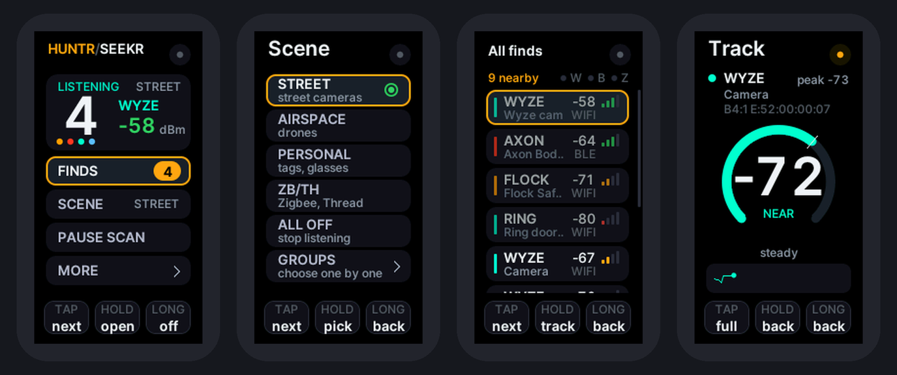
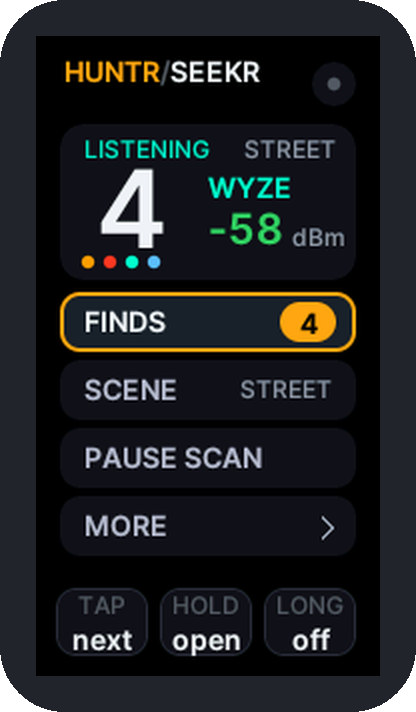
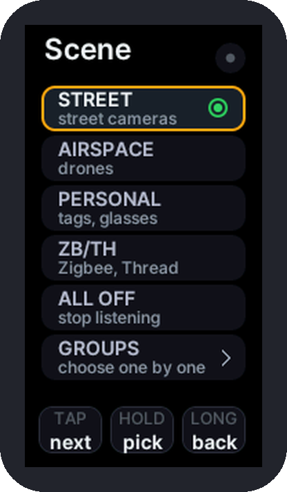
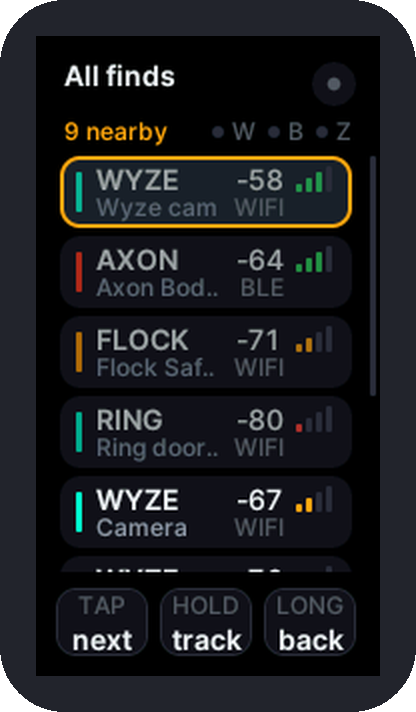
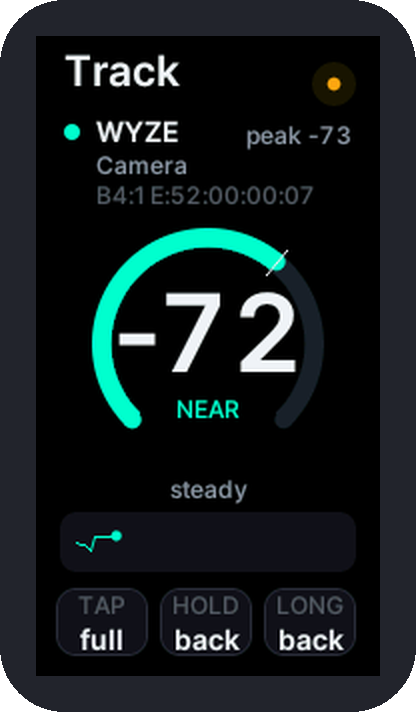

<div align="center">

# HUNTR/SEEKR

**Counter-surveillance signal scanner for the Waveshare ESP32-C6-LCD-1.47 - one-button edition (no touch panel)**




<sub>Screen pictures are renderings of the interface produced by a simulator, not photographs of the board.</sub>

</div>

## What it is

HUNTR/SEEKR turns the **Waveshare ESP32-C6-LCD-1.47** into a pocket radio scanner. It **listens** on the 2.4 GHz band for the wireless signals that certain kinds of devices give off, compares them with built-in lists of known makers and names, and shows you what it heard and how strong each signal is, and lets you follow a signal toward its source.

This edition is for the **plain** board, the one with **no touch panel**. The whole interface is built around the one button the software can read, **BOOT**:

| Gesture | Button held for | Does |
|---|---|---|
| **TAP** | under 0.5 s | **NEXT**: move to the next item |
| **HOLD** | 0.5 s to 1.5 s | **SELECT**: open, start or apply the highlighted item |
| **LONG** | over 1.5 s | **BACK**: go back (on the Home screen: screen off; any press wakes it) |

A strip along the bottom of every screen shows the three gestures and lights up the one you are making, and the RGB LED is the status light: it works by feel and by light with the screen in a pocket. If your board has a touch screen (its name has **Touch** in it), use the [touch edition](../c6-lcd147/) instead.

It is passive: it only receives. It does not jam, attack, or connect to anyone's network.

> **Results are hints, not proof.** Names and addresses can be changed or randomized, many devices are not in the lists, and a quiet device may simply be out of range. "Nothing found" never proves nothing is there.

## What it can find

- **Wi-Fi** devices such as security cameras, doorbells, smart glasses, drones and license-plate readers, from their network names and hardware addresses
- **Rogue Wi-Fi signs**: de-authentication floods, open "evil twin" copies of a protected network name, and one transmitter answering to many names - flagged as warnings, not proof
- **Bluetooth LE** devices such as trackers (AirTag and other Find My trackers, Tile, SmartTag, Google Find Hub, Chipolo, Pebblebee), body cameras, smart glasses, Flipper Zero devices, drones, beacons, wearables, smart lights and Fast Pair accessories, each with a type tag
- **Gunshot sensors and police cameras**: ShotSpotter (SoundThinking) and Flock Raven sensors (shown as GUNSHOT), and body or in-car cameras from makers other than Axon, such as Motorola Solutions and WatchGuard, Digital Ally, COBAN and Utility (shown as BODYCAM). Most are matched by address block or set-up network name, so confidence is lower than for Axon.
- **Zigbee and Thread** smart-home radios (802.15.4)
- **Drone Remote ID**: the serial number and position many drones broadcast
- **Possible card skimmers**: Bluetooth modules still wearing a factory name (the kind sometimes hidden in gas pumps and ATM readers). This is a clue, not a verdict.

## Features

- Five **scenes** (STREET, AIRSPACE, PERSONAL, ZB/TH, ALL OFF) that arm useful sets of detection groups in one step, or pick groups one by one
- Detection groups: ALPR, AXON, CAMS, GLASS, DRONE, BT, TAGS, WIFI, ZIGBEE/THREAD
- Wide maker lists, including many camera, doorbell and tracker makers, gunshot sensors (Flock Raven, ShotSpotter) and police body cameras beyond Axon
- **Finds** list, strongest first, and a **Track** screen with a live signal-strength (dBm) ring; the LED blinks faster as you get closer
- A banner and a group-coloured LED pulse for each new find; tracker "following" alert and possible-skimmer alert
- RGB LED status light; optional buzzer and up to two optional extra buttons
- Findings saved **automatically** (every 5 minutes and when scanning stops), downloadable from the phone page
- Phone page over the board's own Wi-Fi hotspot: live view, clock sync, your own signatures (up to 128) and a signature update file, boot logo, log download
- Discreet mode, brightness levels, and your choices remembered after a restart

<table>
<tr>
<td></td>
<td></td>
<td></td>
<td></td>
</tr>
<tr align="center"><td>Home</td><td>Scenes</td><td>Finds</td><td>Track</td></tr>
</table>

## Install

You need a **Waveshare ESP32-C6-LCD-1.47** board (the plain one, without touch) and a USB **data** cable. Not sure where to start? Read [READ_ME_FIRST.txt](READ_ME_FIRST.txt) and the [help folder](help/).

### Flash the firmware file

1. Download `HUNTR-SEEKR_C6_LCD147_BUTTON_Public_Beta_1.bin` and `SHA256SUMS.txt` from the [Releases page](https://github.com/SKIrf26/HUNTR-SEEKR/releases).
2. Install Python 3, then `pip install esptool`.
3. Plug in the board and run:

   ```
   esptool --chip esp32c6 --port YOUR_PORT --baud 460800 write-flash 0x0 HUNTR-SEEKR_C6_LCD147_BUTTON_Public_Beta_1.bin
   ```
4. The board restarts. The boot screen shows **Public Beta 1** at the bottom.

Writing the image resets saved settings; saved logs stay. Step-by-step help, including checking the download, is in [help/2_FLASHING.txt](help/2_FLASHING.txt) and [firmware/README.md](firmware/README.md).

Prefer a browser? The project's [web flasher](https://skirf-labs.tech/) writes the same file from Chrome or Edge, with nothing to install.

### Build it yourself

The complete source is in [`src/`](src/). [docs/BUILDING.md](docs/BUILDING.md) lists the libraries, the Arduino IDE settings and the command-line build; the board definitions (pins and screen settings) are in [`config/`](config/).

## Documentation

The illustrated user guide covers set-up, the one-button controls, every screen, the LED, troubleshooting and care:

- [User guide (PDF)](docs/HUNTR-SEEKR_C6_LCD147_BUTTON_Public_Beta_1_User_Guide.pdf)
- Booklet versions for printing two-sided: [flip on long edge](docs/HUNTR-SEEKR_C6_LCD147_BUTTON_Public_Beta_1_User_Guide_BOOKLET_flip-long-edge.pdf) / [flip on short edge](docs/HUNTR-SEEKR_C6_LCD147_BUTTON_Public_Beta_1_User_Guide_BOOKLET_flip-short-edge.pdf)
- Plain-text help: [help/](help/) (getting started, flashing, troubleshooting, FAQ)
- For developers: [docs/BUILDING.md](docs/BUILDING.md) and [docs/CODE_MAP.md](docs/CODE_MAP.md)

## Beta status - what to expect

This is the **first public release of this edition**. It is a beta: expect rough edges, and expect some behaviour to change.

- **Hardware status.** This release has been flashed and run on a real plain ESP32-C6-LCD-1.47 by the project: it starts, shows the interface and finds Wi-Fi networks. An earlier one-button build of the same interface (version 3.6-btn) also ran on that board, including the display settings, the LED and reading BOOT as the button. Not every feature has been tried one by one on this release yet (Bluetooth, Zigbee/Thread, the phone page and the saved logs in particular). Please report what you see, good or bad, with the Bug report form.
- This edition has **no direction finder (AIM)**, no landscape screen, no settings pages, session report or self-test: those need a touch screen or a motion sensor, which this board does not have. The touch edition has them.
- There is no speaker on the board. Sound needs a small passive buzzer (see the user guide).
- Update over USB: the phone update page is not supported on this board in this release.
- The board listens on the 2.4 GHz band only. A device on 5 GHz Wi-Fi is not heard.
- The board has one radio shared by Wi-Fi and Bluetooth, so with both armed each hears a little less than it would alone.
- The detection lists are not exhaustive.

Found a problem? Open an issue with the **Bug report** form and include what the Serial Monitor (115200 baud) printed.

## Responsible use

This project is meant for defensive, privacy-protecting use: finding out what is around you. Receiving radio signals that are openly broadcast is lawful in many places, but laws differ, and some places restrict particular uses of scanners or of the information you collect. You are responsible for following the laws where you are. Do not use it to identify, follow or harass individual people. A match is a clue about a device, not evidence about a person or a place.

## Licence

HUNTR/SEEKR is free software released under the **GNU General Public License v3.0** - see [LICENSE](LICENSE). It comes with **no warranty**. Copyright (C) 2026 SKIrf Labs.

It is built with third-party components under their own licences (LGPL, Apache 2.0, BSD, SIL OFL): see [THIRD_PARTY_NOTICES.md](THIRD_PARTY_NOTICES.md).

Waveshare, Espressif, Arduino and all brand and product names that appear in the detection lists or screenshots belong to their owners. This project is not affiliated with, or endorsed by, any of them.

## Project files

| Path | Contents |
|---|---|
| `src/` | The firmware source (Arduino sketch) |
| `config/` | Board definitions (pins, screen) and build settings |
| `help/` | Plain-text help: getting started, flashing, troubleshooting, FAQ |
| `firmware/` | How the release `.bin` is flashed and checked |
| `docs/` | User guide PDFs, build notes, code map, images |
| `tools/` | Script that turns a build into the release `.bin` and checksum |
| `licenses/` | Licence texts of the third-party components |
| `CHANGELOG.md`, `RELEASE_NOTES.md` | What is in each release |
