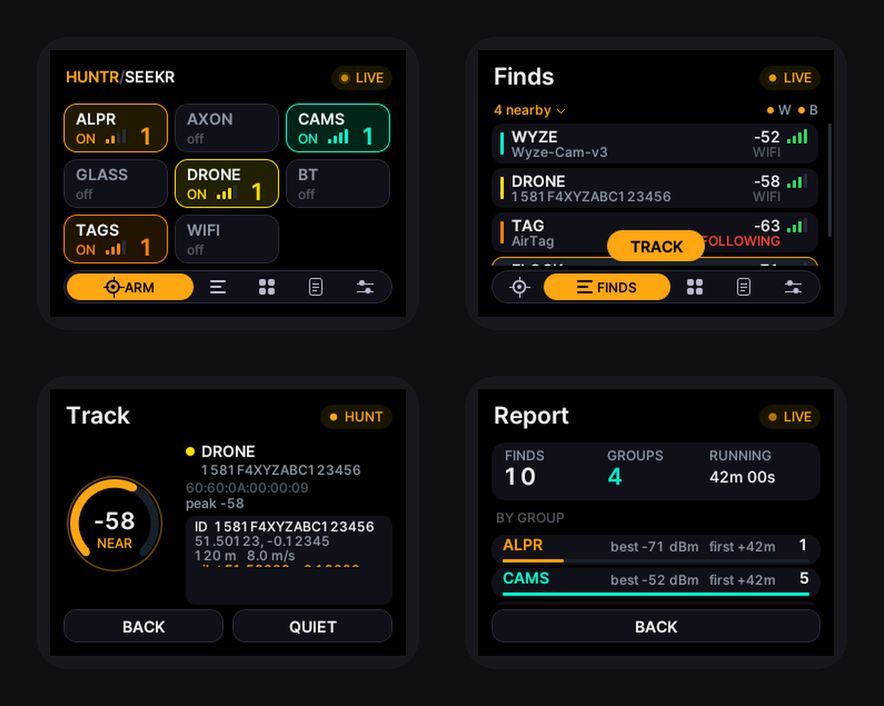
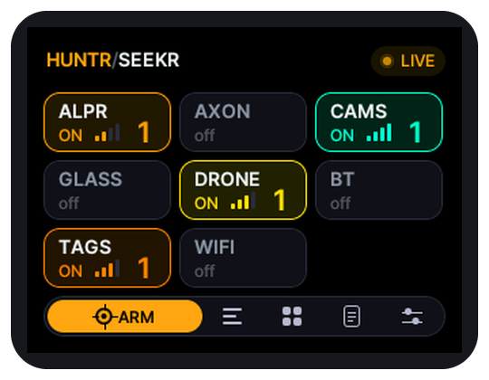
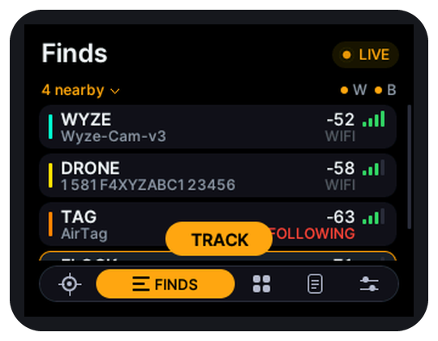
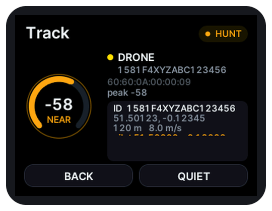
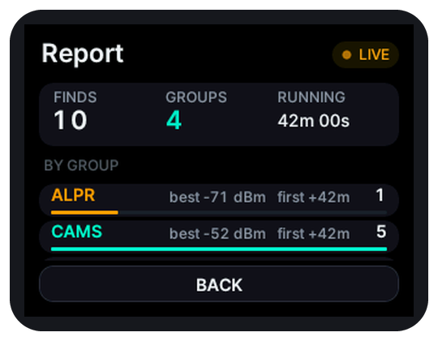

<div align="center">

# HUNTR/SEEKR

**Counter-surveillance signal scanner for the ESP32-2432S028 ("cheap yellow display", CYD 2.8)**




<sub>Screen pictures are renderings of the interface produced by a simulator, not photographs of the board.</sub>

</div>

## What it is

HUNTR/SEEKR turns the ESP32-2432S028 (CYD 2.8) into a pocket radio scanner. It **listens** on the 2.4 GHz band for the wireless signals that certain kinds of devices give off, compares them with built-in lists of known makers and names, and shows you what it heard, how strong each signal is, and lets you follow a signal toward its source.

It is passive: it only receives. It does not jam, attack, or connect to anyone's network.

> **Results are hints, not proof.** Names and addresses can be changed or randomized, many devices are not in the lists, and a quiet device may simply be out of range. "Nothing found" never proves nothing is there.

## What it can find

- **Wi-Fi** devices such as security cameras, doorbells, smart glasses, drones and license-plate readers, from their network names and hardware addresses
- **Rogue Wi-Fi signs**: de-authentication floods, open "evil twin" copies of a protected network name, and one transmitter answering to many names - flagged as warnings, not proof
- **Bluetooth LE** devices such as trackers (AirTag and other Find My trackers, Tile, SmartTag, Google Find Hub, Chipolo, Pebblebee), body cameras, smart glasses, Flipper Zero devices, drones, beacons, wearables, smart lights and Fast Pair accessories, each with a type tag
- **Gunshot sensors and police cameras**: ShotSpotter (SoundThinking) and Flock Raven sensors (shown as GUNSHOT), and body or in-car cameras from makers other than Axon, such as Motorola Solutions and WatchGuard, Digital Ally, COBAN and Utility (shown as BODYCAM). Most are matched by address block or set-up network name, so confidence is lower than for Axon.
- **Drone Remote ID**: the serial number and position many drones broadcast
- **Possible card skimmers**: Bluetooth modules still wearing a factory name (the kind sometimes hidden in gas pumps and ATM readers). This is a clue, not a verdict.

## Features

- Detection groups with live counts: ALPR, AXON, CAMS, GLASS, DRONE, BT, TAGS, WIFI
- Groups can be armed and disarmed in any order; Wi-Fi and Bluetooth groups keep working together, with a **Bluetooth share** option for when Bluetooth finds are slow
- **Track** screen: a live signal-strength (dBm) display with audible feedback so you can walk toward a source
- Wide maker lists, including many camera makers (Amcrest, Lorex, Hikvision, Dahua, Axis, Uniview, Vivotek, Hanwha), home-camera and doorbell makers (Ring, Wyze, Arlo, Blink, Eufy, Canary, Swann, Abode), gunshot sensors, device-fingerprint codes and Bluetooth spam detection
- Custom signatures (oui, ssid, ble, cid, uuid and ie rules, up to 128) and a signature update file (`sigs_update.txt`)
- Tracker "following" alert, ignore list, scenes, session report and logs (saved to a microSD card or the board's flash; with a GPS module also as KML and GeoJSON map files)
- Discreet mode, power saver, landscape and portrait screens, touch calibration, and a Screen colors setting that corrects boards whose display shows swapped or inverted colours
- Phone page over the board's own Wi-Fi hotspot: live view and clock sync
- Self-test screen that checks every part of the hardware

<table>
<tr>
<td></td>
<td></td>
<td></td>
<td></td>
</tr>
<tr align="center"><td>Groups</td><td>Finds</td><td>Track</td><td>Report</td></tr>
</table>

## Install

You need an **ESP32-2432S028 (CYD 2.8)** board and a USB **data** cable. Not sure where to start? Read [READ_ME_FIRST.txt](READ_ME_FIRST.txt) and the [help folder](help/).

### Flash the firmware file

1. Download `HUNTR-SEEKR_CYD_2432S028_Public_Beta_1.bin` and `SHA256SUMS.txt` from the [Releases page](https://github.com/SKIrf26/HUNTR-SEEKR/releases).
2. Install Python 3, then `pip install esptool`.
3. Plug in the board and run:

   ```
   esptool --chip esp32 --port YOUR_PORT --baud 460800 write-flash 0x0 HUNTR-SEEKR_CYD_2432S028_Public_Beta_1.bin
   ```
4. The board restarts. The boot screen shows **Public Beta 1** at the bottom. The first start asks you to calibrate the touch screen: press and hold each of the four crosses.

Writing the image resets saved settings (including the touch calibration); logs on the microSD card stay. Step-by-step help, including checking the download, is in [help/2_FLASHING.txt](help/2_FLASHING.txt) and [firmware/README.md](firmware/README.md).

Prefer a browser? The project's [web flasher](https://skirf-labs.tech/) writes the same file from Chrome or Edge, with nothing to install.

### Build it yourself

The complete source is in [`src/`](src/). [docs/BUILDING.md](docs/BUILDING.md) lists the libraries, the Arduino IDE settings and the command-line build; the display set-up for this board is in [`config/`](config/).

## Documentation

The illustrated user guide covers set-up, every screen, the settings, troubleshooting and care:

- [User guide (PDF)](docs/HUNTR-SEEKR_CYD_2432S028_Public_Beta_1_User_Guide.pdf)
- Booklet versions for printing two-sided: [flip on long edge](docs/HUNTR-SEEKR_CYD_2432S028_Public_Beta_1_User_Guide_BOOKLET_flip-long-edge.pdf) / [flip on short edge](docs/HUNTR-SEEKR_CYD_2432S028_Public_Beta_1_User_Guide_BOOKLET_flip-short-edge.pdf)
- Plain-text help: [help/](help/) (getting started, flashing, troubleshooting, FAQ)
- For developers: [docs/BUILDING.md](docs/BUILDING.md) and [docs/CODE_MAP.md](docs/CODE_MAP.md)

## Beta status - what to expect

This is the **first public release**. It is a beta: expect rough edges, and expect some behaviour to change.

- **Hardware status.** This release has been run on the real board by the project and works, including Wi-Fi scanning and Bluetooth. A Bluetooth start-up fault found on an earlier build is fixed. Not every feature has been tried one by one on the board yet, so some may have had less testing on hardware. Please report what you see, good or bad, with the Bug report form.
- Signal strength is only a rough guide to distance, and one antenna cannot tell which direction a signal comes from. Use the warmer / colder reading and walk around.
- Sound needs a small 8 ohm speaker fitted to the board (see the user guide).
- Update over USB: the phone update page is not supported on this board in this release.
- The board listens on the 2.4 GHz band only. A device on 5 GHz Wi-Fi is not heard.
- The board has one radio shared by Wi-Fi and Bluetooth, so with both armed each hears a little less than it would alone. Turn on SETUP > Bluetooth share if Bluetooth finds are slow.
- The detection lists are not exhaustive.

Found a problem? Open an issue with the **Bug report** form and include what the Serial Monitor (115200 baud) printed.

## Responsible use

This project is meant for defensive, privacy-protecting use: finding out what is around you. Receiving radio signals that are openly broadcast is lawful in many places, but laws differ, and some places restrict particular uses of scanners or of the information you collect. You are responsible for following the laws where you are. Do not use it to identify, follow or harass individual people. A match is a clue about a device, not evidence about a person or a place.

## Licence

HUNTR/SEEKR is free software released under the **GNU General Public License v3.0** - see [LICENSE](LICENSE). It comes with **no warranty**. Copyright (C) 2026 SKIrf Labs.

It is built with third-party components under their own licences (LGPL, Apache 2.0, BSD, SIL OFL): see [THIRD_PARTY_NOTICES.md](THIRD_PARTY_NOTICES.md).

Espressif, Arduino and all brand and product names that appear in the detection lists or screenshots belong to their owners. This project is not affiliated with, or endorsed by, any of them.

## Project files

| Path | Contents |
|---|---|
| `src/` | The firmware source (Arduino sketch) |
| `config/` | Display library set-up for this board |
| `help/` | Plain-text help: getting started, flashing, troubleshooting, FAQ |
| `firmware/` | How the release `.bin` is flashed and checked |
| `docs/` | User guide PDFs, build notes, code map, images |
| `tools/` | Script that turns a build into the release `.bin` and checksum |
| `licenses/` | Licence texts of the third-party components |
| `CHANGELOG.md`, `RELEASE_NOTES.md` | What is in each release |
